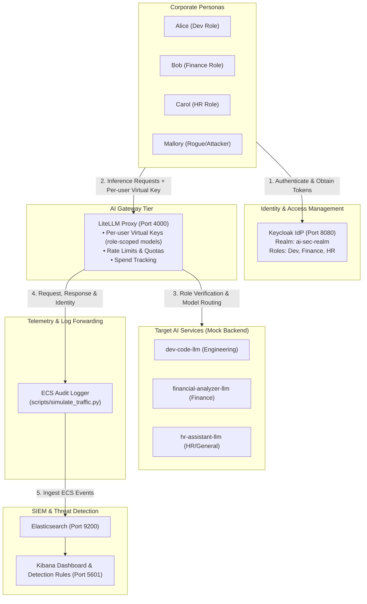

# 🛡️ Enterprise AI Usage Monitoring & Security Operations Lab (Flagship Project)

[-0078D6?logo=windows&logoColor=white)](#)
[](#)
[-E43717?logo=redhat&logoColor=white)](#)
[](#)
[](#)
[](#)

> **Author**: **Bhavithra SR**  
> **Academic Context**: MSc in Cybersecurity  
> **Career Target**: SOC Analyst | Detection Engineer | Cloud & AI Security Engineer

---

## 📌 Executive Summary

As enterprise adoption of generative AI accelerates, organizations face unprecedented risks: **Shadow AI usage, unmonitored employee data leakage, credential exposure, prompt injection, and uncapped cloud expenditures**. Traditional network firewalls and endpoint detection agents are blind to semantic-layer risks embedded in natural language inference payloads.

This flagship lab implements a **production-ready, zero-cloud-cost AI Security Operations Center (SOC) ecosystem**:
1. **AI Gateway Reverse Proxy**: Deploys **LiteLLM Proxy** in front of 3 domain-specific models (`dev-code-llm`, `financial-analyzer-llm`, and `hr-assistant-llm`).
2. **Identity & Role-Based Access Control (RBAC)**: Personas authenticate against **Keycloak OIDC**; each user's realm role (**Engineering / Dev**, **Finance**, **HR**) maps to a per-user LiteLLM virtual key restricted to that role's models, so the gateway itself returns **HTTP 403** for out-of-role model calls.
3. **SIEM Telemetry Pipeline**: Emits structured Elastic Common Schema (ECS) audit events to **Elasticsearch / Kibana**.
4. **8 Enterprise Security Detections**: Detection rules deployed to the **Elastic Security** detection engine (KQL / Lucene) and written as portable **Sigma YAML**, mapped directly to **OWASP Top 10 for LLM** and **MITRE ATLAS**.
5. **Adversarial Attack Generator**: Automated Python test engine simulating both normal employee traffic and 8 distinct cyber attacks.
6. **Executive & SOC Dashboards**: Pre-built visualizations for usage patterns, token costs, and real-time threat response.

---

## 🏗️ Architecture Diagram



---

## 🎯 Threat Detection Matrix

All 8 detection rules are implemented as **Elastic Security** rules (`detections/rules_elastic.kql`, deployed by `scripts/create_elastic_rules.py`) and as vendor-neutral **Sigma YAML** (`detections/sigma/`):

| # | Detection Name | Threat Scenario | OWASP LLM Top 10 | MITRE ATLAS | Severity |
|---|----------------|-----------------|------------------|-------------|:---:|
| **1** | **Personal Data (PII) in Prompts** | Employee pastes Credit Card numbers, SSNs, NHS numbers, or email dumps into LLM prompts. | **LLM02**: Sensitive Information Disclosure | **AML.T0024**: Exfiltration via ML Inference | **HIGH** |
| **2** | **Bulk Data Upload / Exfiltration Burst** | Sudden anomalous token volume burst (>4,000 tokens/req or >20,000 tokens/5m) indicating document dumps or database exfiltration. | **LLM02**: Sensitive Info Disclosure & **LLM04**: Model DoS | **AML.T0024**: Exfiltration & **AML.T0029**: Denial of ML Service | **HIGH** |
| **3** | **Unauthorized Model Access (RBAC Violation)** | An HR user tries accessing code-generation or financial forecasting models, or unauthorized persona attempts access. | **LLM06**: Insecure Authorization / Excessive Agency | **AML.T0012**: Valid Accounts & **AML.T0016**: Obtain Capabilities | **MEDIUM** |
| **4** | **Shadow AI Access via Proxy Logs** | Employee bypasses the sanctioned LiteLLM gateway and accesses unapproved external AI domains (`chatgpt.com`, `claude.ai`, `deepseek.com`, `poe.com`). | **LLM02**: Sensitive Information Disclosure | **AML.T0010**: ML Supply Chain Compromise / Evasion | **MEDIUM** |
| **5** | **Prompt Injection & Jailbreak Attempt** | Attacker utilizes DAN ("Do Anything Now"), "ignore previous instructions", delimiter attacks, or system prompt extraction. | **LLM01**: Prompt Injection | **AML.T0051**: LLM Prompt Injection & **AML.T0054**: LLM Jailbreak | **CRITICAL** |
| **6** | **Credential & Secret Leakage in Prompts** | Developer accidentally pastes AWS keys (`AKIA...`), GitHub tokens (`ghp_...`), or private SSH keys into code prompts. | **LLM02**: Sensitive Information Disclosure | **AML.T0048**: Discover ML Artifacts / Exfiltration | **CRITICAL** |
| **7** | **Off-Hours / Anomalous Usage Spike** | High-volume inference requests executed outside business hours (01:00 - 05:00 AM) or anomalous burst frequency. | **LLM06**: Insecure Authorization | **AML.T0012**: Valid Accounts (Account Takeover) | **MEDIUM** |
| **8** | **Reconnaissance & Excessive Client Errors** | Attacker probes endpoint schemas and guardrails, generating an abnormal spike of 400 Bad Request / 403 Forbidden / 429 Rate Limits. | **LLM01**: Prompt Injection / **LLM04**: DoS | **AML.T0002**: ML Model Discovery / Reconnaissance | **MEDIUM** |

---

## ⚡ Quickstart (Windows, native)

### Prerequisites
- Windows 10/11 with PowerShell
- Python 3.12
- PostgreSQL (for LiteLLM keys & spend tracking), listening on `:5432`
- Elasticsearch 8.12 (`:9200`) and Kibana 8.12 (`:5601`), installed locally, with security enabled (step 2)
- Java 17+ and [Keycloak 24](https://www.keycloak.org/downloads) unzipped to `C:\keycloak-24.0.1` (or set `KEYCLOAK_HOME` in `.env`)

### 1. One-time setup
```powershell
cd ai-monitoring-lab
py -3.12 -m venv .venv
.venv\Scripts\pip install "litellm[proxy,extra_proxy]" prisma fastapi uvicorn requests
copy .env.example .env     # then set DATABASE_URL and the Elasticsearch passwords
```

### 2. Secure Elasticsearch & Kibana (one-time)
Elasticsearch runs with **`xpack.security` enabled**, so every client authenticates and Kibana's Security app (Alerts, Rules, Timeline) works fully.

1. In `elasticsearch.yml` set `xpack.security.enabled: true` (single-node, HTTP on localhost).
2. Before the first secured start, store the `elastic` user's password as the bootstrap password:
   ```powershell
   bin\elasticsearch-keystore.bat add -x bootstrap.password   # type the ELASTIC_PASSWORD from .env
   ```
3. Start Elasticsearch, then set the `kibana_system` password:
   ```powershell
   curl.exe -u elastic:<ELASTIC_PASSWORD> -X POST http://localhost:9200/_security/user/kibana_system/_password `
     -H "Content-Type: application/json" -d '{\"password\":\"<KIBANA_SYSTEM_PASSWORD>\"}'
   ```
4. Add to `kibana.yml`, then start Kibana and log in as **`elastic`**:
   ```yaml
   elasticsearch.username: "kibana_system"
   elasticsearch.password: "<KIBANA_SYSTEM_PASSWORD>"
   xpack.encryptedSavedObjects.encryptionKey: "<any random string, 32+ characters>"
   ```

The lab scripts read `ELASTIC_USERNAME` / `ELASTIC_PASSWORD` from `.env`.

### 3. Launch the lab
```powershell
.\scripts\start_lab.ps1                  # start Mock AI + LiteLLM and run the simulation
.\scripts\start_lab.ps1 -SkipSimulation  # start services only
.\scripts\start_lab.ps1 -Stop            # stop Keycloak + Mock AI + LiteLLM
```
`start_lab.ps1` loads `.env`, checks PostgreSQL / Elasticsearch / Kibana are reachable, starts **Keycloak** (`:8080`, importing `config/keycloak_realm.json` on first run), the **Mock AI backend** (`:8001`) and the **LiteLLM gateway** (`:4000`) in their own windows, waits for them to be healthy, then runs `scripts/simulate_traffic.py` to generate baseline department traffic and all 8 attack scenarios.

`scripts/run_litellm.py` wraps LiteLLM to work around a Windows-only crash (its `os.kill(pid, 0)` health check sends Ctrl+C to the console).

### Personas (Keycloak realm `ai-sec-realm`)

| User | Password | Realm role | Department | Gateway key allows |
| :--- | :--- | :--- | :--- | :--- |
| `alice.dev` | `DevPassword123!` | `role_dev` | Engineering | `dev-code-llm`, `hr-assistant-llm` |
| `bob.finance` | `FinancePassword123!` | `role_finance` | Finance | `financial-analyzer-llm`, `hr-assistant-llm` |
| `carol.hr` | `HRPassword123!` | `role_hr` | Human Resources | `hr-assistant-llm` |
| `mallory.attacker` | `RoguePassword123!` | `role_hr` | Contractor | `hr-assistant-llm` |

**How a simulation run works:**
1. Each persona logs in to Keycloak (password grant, client `litellm-proxy`). Name, email, role, department and cost centre are read from the **access token** (`user.id` is the Keycloak subject; `labels.identity_source: keycloak`).
2. The simulator provisions a per-user **LiteLLM virtual key** limited to the models of that role (`ROLE_MODELS` in `scripts/simulate_traffic.py`).
3. Benign prompts and the attacks aimed at the gateway are sent **through LiteLLM with the user's own key** — out-of-role calls (Carol → `dev-code-llm`, Mallory → `admin-control-llm`) are rejected by the gateway with a real **HTTP 403**.
4. The Shadow-AI scenario bypasses the gateway by definition, so it is logged as a proxy event. The off-hours scenario is backdated to the most recent 02:41 UTC.

Every event is written to Elasticsearch with scenario labels (`security.rule_name`, `severity`, …) for the dashboard; the Elastic detection rules do **not** rely on those labels — they match on prompt content, models, status codes and hosts.

> If Keycloak is unreachable, the simulator falls back to local persona data (`labels.identity_source: local`) and warns; if a key can't be created it falls back to the master key and warns that RBAC isn't enforced.

---

## 🌐 Service Access Endpoints

| Portal / Service | URL | Default Credentials | Description |
| :--- | :--- | :--- | :--- |
| **LiteLLM AI Gateway** | [http://localhost:4000](http://localhost:4000) | Bearer Token in `.env` | Sanctioned API reverse proxy |
| **Kibana SOC Dashboard** | [http://localhost:5601](http://localhost:5601) | `elastic` / `ELASTIC_PASSWORD` from `.env` | SIEM visualization, alerts & threat hunting |
| **Keycloak IAM Admin** | [http://localhost:8080](http://localhost:8080) | `admin` / `adminpassword123!` | Identity Provider (OIDC / OAuth2) |
| **Mock AI Backend** | [http://localhost:8001](http://localhost:8001/v1/models) | Anonymous | Local OpenAI-compatible model host |
| **Elasticsearch API** | [http://localhost:9200](http://localhost:9200) | `elastic` / `ELASTIC_PASSWORD` from `.env` | Raw log ingestion & search |

---

## 📊 Visualizing in Kibana

1. Open **`http://localhost:5601`** in your browser and log in as `elastic`.
2. Navigate to **Management** > **Stack Management** > **Saved Objects**.
3. Click **Import** and upload `dashboards/kibana_dashboard.ndjson`.
4. Open the newly imported dashboard: **`[SOC] AI Security & Governance Monitoring Dashboard`** (time range is saved as *Last 30 days*).

The import also creates:
- the **AI Audit Logs** data view (`ai-audit-logs*`) for Discover, including the `event.hour_of_day` runtime field, and
- the **AI Lab - Security Alerts** saved search (Discover → Open) listing detection-rule alerts.

Useful Discover queries: `security.is_alert : true`, `user.name : "Mallory RogueUser"`, `ai.status_code >= 400`, `ai.tokens.prompt > 1000`.

---

## 🚨 Deploying Detection Rules (Elastic Security)

1. Give Kibana a permanent encryption key so rules survive restarts — add to `kibana.yml` and restart Kibana:
   ```yaml
   xpack.encryptedSavedObjects.encryptionKey: "<any random string, 32+ characters>"
   ```
2. Import the dashboard first (it creates the `ai-audit-logs*` data view the rules use), then run:
   ```bash
   python scripts/create_elastic_rules.py
   ```
   This creates/updates the 8 rules from `detections/rules_elastic.kql` (every 5 minutes, 6-minute lookback) and adds the `event.hour_of_day` runtime field used by the off-hours rule.
3. Run `scripts/simulate_traffic.py`, wait ~5 minutes, then open **Security → Alerts** (triage, assign, close as false positive, investigate in Timeline). The **AI Lab - Security Alerts** saved search in Discover shows the same alerts as a table.

> The off-hours rule only fires on events from the last 6 minutes, while the simulator backdates its off-hours event to the most recent 02:41 UTC — so that rule won't alert on simulator runs.

---

## 🔬 Validating Detection Rules

You can re-run the simulation at any time:
```bash
python3 scripts/simulate_traffic.py
```

### Verify in Elasticsearch via curl:
```bash
# Count total ingested logs
curl -s -u "elastic:$ELASTIC_PASSWORD" "http://localhost:9200/ai-audit-logs/_count" | jq .

# Find all High and Critical alerts
curl -s -u "elastic:$ELASTIC_PASSWORD" -X POST "http://localhost:9200/ai-audit-logs/_search" \
  -H "Content-Type: application/json" \
  -d '{
    "query": {
      "bool": {
        "must": [{ "term": { "security.is_alert": true } }],
        "filter": [{ "terms": { "security.severity": ["high", "critical"] } }]
      }
    }
  }' | jq '.hits.hits[]._source | {user: .user.name, rule: .security.rule_name, severity: .security.severity}'
```

---

## 📚 Dedicated Documentation & Knowledge Transfer

This project includes two detailed reference documents located in the `learning/` directory:

1. **[Learning Guide (`learning/LEARNING_GUIDE.md`)](learning/LEARNING_GUIDE.md)**:
   - Career transformation: How Support Analyst competencies (ticket triage, root cause analysis, SLA management) translate directly into SOC Incident Response (NIST SP 800-61 / PICERL).
   - In-depth theoretical exploration of **OWASP Top 10 for LLMs** with real-world enterprise analogies.
   - Breakdown of the **MITRE ATLAS** taxonomy for adversarial machine learning.
   - Enterprise AI governance standards: **EU AI Act**, **NIST AI RMF 1.0**, and **ISO/IEC 42001**.

2. **[Knowledge Transfer & Operations Guide (`learning/KNOWLEDGE_TRANSFER.md`)](learning/KNOWLEDGE_TRANSFER.md)**:
   - Complete technical walk-through with **every single inline command explained**.
   - SOC Alert Triage Playbooks for all 8 threat detections.
   - Troubleshooting guide for port bindings, memory allocations, and gateway connections.
   - **Hard Cybersecurity Interview Questions & Answers** for presenting this project to hiring managers.

---

## 🗺️ Roadmap

- **Docker Compose deployment** — one-command setup of the full stack.
- **Microsoft Sentinel (Azure)** — forward the same ECS events to Sentinel, with the 8 rules in Sentinel KQL and an AI-security workbook.
- **Gateway-side token validation** — have LiteLLM validate Keycloak JWTs directly (LiteLLM Enterprise feature); today roles are enforced via per-user virtual keys.

---

## 📄 License & Attribution
Developed for educational research and professional portfolio demonstration by **Bhavithra SR**.  
Released under the **[MIT License](LICENSE)**.
